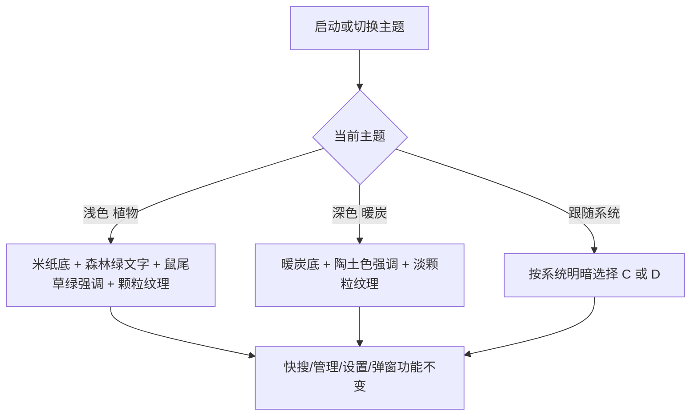

# SPEC-20 视觉定版：植物 / 暖炭主题地基与 HeaderBar 迁移

> 视觉源：`docs/prds/file-templates-ui-requirements.md` 第一部分第 10 节、第二部分第 1、6 节；`docs/prds/file-templates-ui-theme-preview.html`（定版预览，`botanical` 与 `claude-dark` 两段）  
> 参考：`docs/ref/botancial.md`（已改编采用，非原样照搬）；`docs/ref/Art Deco.md` 未采用  
> 本 spec 回退 SPEC-17～19 的液态玻璃配方，但保留其建立的 token 体系与后端主题真相源

## 基本信息

- Spec ID：`SPEC-20`
- 标题：视觉定版：植物 / 暖炭主题地基与 HeaderBar 迁移
- SpecFlow spec：`visual-foundation`（状态以 `../state.yaml` 为准）
- 关联阶段：Phase 10（文件模板、分组与视觉定版）第一 slice
- 关联 PRD：A-17、FR-VIS-01、FR-VIS-02、FR-SET-01（主题展示名）、NFR 11.4、AC-38、D-17
- 前置 Spec：SPEC-19（`done`）
- 允许修改范围：
  - `src/index.css`（token 替换、去玻璃、形状/字体/动效/纹理）
  - `src/main.tsx`（仅首帧主题缓存相关）
  - `src/App.tsx`（仅删除 HeaderBar 引用与挂载左栏底部按钮所需的回调传递）
  - `src/components/HeaderBar.tsx`（删除）
  - `src/components/ManagerWindow.tsx`（仅左栏底部按钮栏、删除标题旁重复设置按钮、图标 strokeWidth、className 调整）
  - `src/components/QuickSearchWindow.tsx`、`src/components/ui/command.tsx`、`src/components/ui/SelectField.tsx`（仅样式类名与图标 strokeWidth，不改行为；`command.tsx` 可为焦点环新增无行为的样式包裹元素——2026-10-15 人工授权）
  - `src/components/SettingsModal.tsx`、`AboutModal.tsx`、`KeyboardShortcutsModal.tsx`（仅样式类名、主题展示名文案、图标 strokeWidth）
  - `src/components/ThemeProvider.tsx`（仅主题展示名；以及 `prefers-reduced-motion: reduce` 时不添加 `theme-transition` 的守卫——2026-10-15 人工授权）
  - `src/assets/fonts/`（新增 Playfair Display、Source Sans 3 拉丁子集 woff2；删除 Figtree）
  - `src-tauri/tauri.conf.json`、`src-tauri/tauri.e2e.conf.json`（仅 `main` 窗口 `transparent` 项）
  - `e2e/**`（更新与玻璃/旧配色相关的视觉断言；新增本 spec 要求的回归断言：焦点环、reduced-motion、placeholder 对比度、主题 token——2026-10-15 人工授权）
- 禁止修改范围：
  - `src-tauri/src/**`（全部 Rust 业务、存储、平台层）
  - `src/api/**`、`src/types/**`、`src/lib/**`（数据契约）
  - 任何键盘行为、检索、复制、粘贴、设置持久化逻辑
  - 分组、语言、文件模板相关的任何 UI 结构（SPEC-21～24 承担）
  - `docs/prds/**`、`.agent/**`、`.specflow/system-specs/**`、本 change 的规划工件（`proposal.md`、`specs/`、`contracts/`、`design.md`、`ux-design.md`，Planner 专属）

## 背景与目标

Phase 9 落地了液态玻璃（`backdrop-filter` 半透明面板 + 氛围光）。2026-10-15 的需求讨论决定整体废弃玻璃，改为两套不透明主题：浅色“植物 Botanical”（米纸底、森林绿文字、鼠尾草绿强调、纸张颗粒）与深色“暖炭 Ember”（暖炭底、陶土色强调）。两套共用同一套形状与字体，切换主题时只有颜色变化。同时 HeaderBar 在 commit `a26c81a` 被重新接回 `App.tsx`，需求决定删除它，把三个按钮移到管理窗口左栏底部。

本 slice 先交付“视觉地基”：后续 SPEC-21～24 新增的界面都直接在新 token 上构建，避免改两遍样式。用户可观察结果：打开任一窗口即看到新主题，切换浅色、深色、跟随系统时颜色正确，所有现有功能不变。

## 用户故事 / 成功标准

- 作为：Searchis 用户
- 我希望：界面采用温暖、不透明、有纸张质感的新主题，按钮集中在左栏底部
- 从而：长时间使用更舒适，界面结构为文件模板扩展做好准备

成功标准：

- [ ] `grep -rn "backdrop-filter" src/` 无结果；`--color-surface-glass-*`、`--color-canvas-glow-*`、`--blur-radius` 及 `.main-window-shell::before` 氛围光被删除且零引用。
- [ ] `src/index.css` 中 `:root`（浅色）与深色两组 token 的取值与需求文档第二部分第 6 节“颜色 token”表逐项一致；新增 `--color-highlight`（匹配高亮）与文件类型、语法高亮 token（供 SPEC-21/22 使用，本 spec 只声明）。
- [ ] 形状：快搜窗口 26px；卡片、代码块 18px；列表行 14px；输入框、按钮、快捷键标签、徽标为胶囊形。字体：标题 `"Playfair Display", "Noto Serif CJK SC", serif`（只用于 ≥18px 标题，中文不加斜体）；正文 `"Source Sans 3", "Noto Sans CJK SC", sans-serif`；等宽 JetBrains Mono。
- [ ] Playfair Display（500、600、500 italic）与 Source Sans 3（400、500、600）拉丁子集 woff2 随包发货；Figtree 字体文件与 `@font-face` 全部删除且零引用。
- [ ] 窗口背景有 SVG 纸张颗粒层（`pointer-events:none`），浅色约 0.06、深色约 0.035（实机调定后写回本 spec）。
- [ ] 输入框为填充底、无边框，焦点时 2px 强调色光环带偏移；主按钮实心、次要按钮描边，每个界面最多一个主按钮；lucide 图标统一 `strokeWidth={1.5}`。
- [ ] 动效：快搜窗口选中/悬停过渡 ≤150ms、弹出 ≤200ms；管理窗口悬停 ≤300ms ease-out；列表不做卡片上浮；`prefers-reduced-motion` 下关闭非必要动画。
- [ ] `HeaderBar.tsx` 删除，`grep -rn "HeaderBar" src/` 无结果；快捷键速查、主题切换、设置三个按钮位于管理窗口左栏底部横向排列，行为与原 HeaderBar 一致；左栏标题旁的设置按钮删除。
- [ ] 主题展示名改为“浅色 植物”“深色 暖炭”“跟随系统”；存储值仍为 `light`/`dark`/`system`，不迁移数据。
- [ ] `main` 窗口 `transparent` 改为 `false`（KDE 原生装饰，不需要透明）；`search` 窗口保持 `transparent: true` 以显示圆角。
- [ ] 浅色与深色下正文、muted 文字、选中态、主按钮文字对比度经工具复核满足 WCAG AA，复核数值写入实施记录。
- [ ] `npm run build` 通过；`npm run test:e2e` 通过；KDE Global Menu 五组菜单仍显示。

## 非目标

- 本 spec 不实现：分组树、类型筛选、语言下拉与语法高亮、文件模板 UI、设置视图 S1 改版、快捷键速查内容改版（SPEC-21～24）。
- 不引入新的动画库或 CSS 框架；不改 KDE 窗口装饰。
- 不调整任何文案以外的交互行为。

## 用户流程



## 接口与契约

### 输入 / 输出

- 输入：后端 `settings.theme`（不变）。
- 输出：仅视觉变化；左栏底部按钮触发的回调与原 HeaderBar 相同（打开快捷键速查、切换主题、打开设置）。

### 应用服务 / IPC / 平台接口

| 名称 | 请求 | 成功返回 | 错误码 | 幂等要求 |
|---|---|---|---|---|
| 无新增 IPC | — | — | — | — |

### 数据契约

```text
无业务数据变更。CSS token 命名沿用 SPEC-17 体系（--color-canvas/surface/fg/border/accent/...），
新增：--color-highlight、--color-icon-bg、--color-btn-secondary-border、--color-focus-ring、
      --color-file-doc/sheet/pdf/code、--color-syntax-keyword/string/comment/number、
      --radius-window(26px)/--radius-card(18px)/--radius-row(14px)/--radius-pill(999px)、
      --font-heading/--font-body/--font-mono、--grain-opacity。
删除：--color-surface-glass-header、--color-surface-glass-sidebar、--color-canvas-glow-*、--blur-radius。
```

## 数据与状态变化

- 新增状态：无。持久化影响：无。事务边界：不涉及。索引影响：无。迁移要求：无（主题存储值不变）。

## 平台行为

- KGlobalAccel、X11 窗口激活、X11 键盘事件注入、系统剪贴板、XDG Autostart：`not_applicable`
- D-Bus AppMenu：`not_applicable`（回归验证菜单仍显示）
- 能力不可用时的降级行为：KWin 合成器关闭时快搜窗口四角可能显示为直角黑底，属已知可接受现象，记录到实施记录。

## 安全与隐私

- 不涉及用户数据、日志、加密、导出。

## 边界与失败场景

| 场景 | 预期行为 | 错误码 | 是否保留原状态 |
|---|---|---|---|
| 系统未安装 Noto CJK | 中文退回系统默认字体，界面可用 | — | 是 |
| `prefers-reduced-motion: reduce` | 关闭过渡动画，交互即时生效 | — | 是 |
| 合成器关闭 | 快搜窗口圆角外区域不透明，功能不变 | — | 是 |
| 主题切换中途重启 | 首帧按后端主题缓存渲染，无闪烁回退到错误主题 | — | 是 |

## 实施要求

1. 只修改“允许修改范围”内的文件。
2. 颜色只写在 `src/index.css` 的 token 中；组件只引用 token，不新增硬编码颜色。
3. 不改变任何 `data-*`、`aria-*`、`role` 与 E2E 依赖的选择器语义；必须改选择器时同步更新 `e2e/**`。
4. 字体文件来源记录在实施记录中（如 `@fontsource/playfair-display`、`@fontsource/source-sans-3` 的 latin 子集），并确认许可证为 OFL。

## 测试点

### 单元测试

- [ ] 不涉及 Rust 逻辑。

### 集成测试

- [ ] `npm run build` 通过。
- [ ] `npm run test:e2e` 通过；视觉探针改为断言新主题的不透明背景色。
- [ ] 机械检查：`grep -rn "backdrop-filter\|glass\|canvas-glow\|Figtree\|HeaderBar" src/` 无结果（注释除外须同时删除）。

### 手动验收

- [ ] 在目标 Arch/KDE/X11 实机，浅色与深色分别截图：快搜窗口、管理窗口（列表+详情）、设置、快捷键速查、关于、确认对话框，共 12 张，存入 `artifacts/spec-20/`。
- [ ] 与 `file-templates-ui-theme-preview.html` 对照，颜色、圆角、字体一致。
- [ ] 左栏底部三个按钮可用；KDE Global Menu 五组菜单显示。

### 性能与资源

- [ ] 新增字体文件总大小记录到实施记录（预期 < 400 KB）。

## 执行与记录（SpecFlow）

> 2026-10-15 起本 spec 由 SpecFlow 管理（change `phase10-file-templates`，spec `visual-foundation`）。原“实施记录 / QA Result / 完成定义”三节作废，替代关系如下：

- 实施记录 → `handoffs/<task-id>.result.yaml`（`changed_files`、`test_results`、`unresolved_issues`）。
- QA Result → `reviews/<task-id>.md`（含 Design Conformance 节），结论由 runtime 导入后推进状态。
- 手动 / 实机验收项 → QA 报告的“实机验收”清单标为 `pending_human`，由人在归档审批前于 `test_report.md` 执行并勾选；失败时用 `specflow reopen-qa` 退回。
- 完成定义 → 本 spec 的 Delta Spec 场景全部有证据、QA `pass`、`tasks.md` 对应条目勾选。
