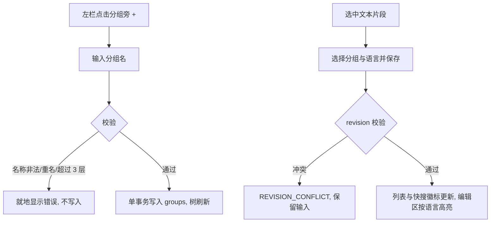

# SPEC-21 分组树与文本片段语言标记（Schema v4）

## 基本信息

- Spec ID：`SPEC-21`
- 标题：分组树与文本片段语言标记（Schema v4）
- SpecFlow spec：`groups-language`（状态以 `../state.yaml` 为准）
- 关联阶段：Phase 10 第二 slice
- 关联 PRD：A-15、FR-SNP-01（`language`、`groupId`）、FR-GRP-01、FR-GRP-02、FR-MGT-01（类型筛选的“文本”部分）、FR-VIS-02（左栏结构）、8.1、8.1.1、AC-21（不含目录部分）、AC-22（不含目录部分）、AC-23、D-13
- 前置 Spec：SPEC-20
- 允许修改范围：
  - `src-tauri/src/model.rs`、`storage.rs`、`service.rs`、`commands.rs`、`lib.rs`、`validation.rs`、`search_index.rs`、`error.rs`
  - `src/api/**`、`src/types/**`
  - `src/components/ManagerWindow.tsx`、`src/components/QuickSearchWindow.tsx`、`src/App.tsx`
  - `src/components/ui/**`（新增分组树、语言下拉、代码编辑器组件）
  - `src/index.css`（只用 SPEC-20 已声明的 token）
  - `package.json`、`package-lock.json`（新增 CodeMirror 6 依赖）
  - `e2e/**`
- 禁止修改范围：
  - 模板目录、文件系统操作、`kind=file` 相关字段（SPEC-22）
  - 剪贴板、自动粘贴、平台层 `src-tauri/src/platform/**`
  - 备份格式（SPEC-24）
  - `docs/prds/**`、`.agent/**`、`.specflow/system-specs/**`、本 change 的规划工件（`proposal.md`、`specs/`、`contracts/`、`design.md`、`ux-design.md`，Planner 专属）

## 背景与目标

条目变多后需要按业务归类；同时命令、SQL、配置类片段需要语法高亮和类型标识。本 slice 让用户在管理窗口建立最多 3 层的分组树、把文本片段放进分组、为文本片段选择语言并获得高亮，快搜窗口与列表显示语言徽标。

本 slice 只处理数据库中的分组，不创建磁盘目录；分组与 `templates/` 目录的同步由 SPEC-22 在引入模板目录时一并实现（SPEC-22 首次启动时为已有分组补建目录）。

## 用户故事 / 成功标准

- 作为：管理大量片段的用户
- 我希望：用分组树归类片段，并为代码类片段标注语言
- 从而：浏览时能按业务定位，编辑时有高亮，列表里一眼区分类型

成功标准：

- [ ] Schema 迁移到 v4：新增 `groups` 表；`snippets` 新增 `group_id`（可空）与 `language`（默认 `plain`）；迁移在单事务中完成，失败时保留原库并输出不含正文的诊断日志；已有片段迁移后为未分组、`plain`。
- [ ] 左栏结构为：全部、置顶、最近使用；分组树（可折叠、带“+”新建、含“未分组”，显示条目数）；标签（整块可折叠）；回收站；底部按钮栏（SPEC-20）。
- [ ] 分组新建、重命名、移动、删除符合 FR-GRP-01/02：名称校验、同级不区分大小写唯一、最多 3 层、删除非空分组需确认且内容整体上移、重名子分组加 `(2)`。
- [ ] 右栏文本片段表单新增“分组”和“语言”下拉；编辑区换为 CodeMirror 6，按语言高亮（plain/bash/sql/yaml/json/toml/ini），配色用 SPEC-20 的语法 token；中文输入法、Ctrl+Z、粘贴、Tab 行为正常。
- [ ] 中栏列表顶部新增“全部 / 文本 / 文件”类型筛选（“文件”在本 slice 始终为空，显示通用空状态）；每行显示类型图标、标题、Key、语言徽标（`language≠plain` 时）。
- [ ] 快搜窗口结果行改为方案 Q-A：左侧类型图标（按 language），中间标题，副标题为 Key · 分组 · 使用次数，右侧徽标与 `Ctrl+N` 序号；匹配片段用 `--color-highlight` 高亮。
- [ ] 检索排序（FR-SCH-02）不变；分组名不参与检索（PRD 未要求）。
- [ ] 复制、粘贴结果与正文逐字节一致（语言只影响显示）。
- [ ] `cargo test`、`npm run build`、`npm run test:e2e` 通过。

## 非目标

- 不创建或同步磁盘目录；不实现文件模板；不改备份格式（v1 备份导出时新字段如何处理见“数据契约”）。
- 不支持条目拖拽排序；分组排序按名称（`sortOrder` 字段预留）。
- 不做语言自动识别。

## 用户流程



## 接口与契约

### 应用服务 / IPC / 平台接口

| 名称 | 请求 | 成功返回 | 错误码 | 幂等要求 |
|---|---|---|---|---|
| `group_list` | — | `Group[]`（含各组条目数） | `DB_OPEN_FAILED` | 只读 |
| `group_create` | `{ name, parentId, requestId }` | `Group` | `GROUP_NAME_INVALID`、`GROUP_NAME_CONFLICT`、`GROUP_DEPTH_EXCEEDED`、`DB_WRITE_FAILED` | 同 `requestId` 不重复创建 |
| `group_update` | `{ id, revision, name, parentId }` | `Group` | 同上 + `REVISION_CONFLICT` | revision 校验 |
| `group_delete_preview` | `{ id }` | `{ snippetCount, childGroupCount }` | — | 只读 |
| `group_delete` | `{ id, revision }` | `{ movedSnippets, movedGroups }` | `REVISION_CONFLICT`、`DB_WRITE_FAILED` | 已删除时返回 0 |
| `snippet_create` / `snippet_update` | 新增 `groupId`、`language` 字段 | `Snippet` | 新增 `VALIDATION_FAILED`（未知 language 或分组不存在） | 不变 |
| `search_snippets` | 不变 | `SearchResultItem` 新增 `language`、`groupName`、`kind` | 不变 | 不变 |

### 数据契约

```text
groups(id TEXT PK, name TEXT NOT NULL, parent_id TEXT NULL REFERENCES groups(id),
       depth INTEGER CHECK(depth BETWEEN 1 AND 3), sort_order INTEGER DEFAULT 0,
       created_at, updated_at, revision INTEGER >= 1)
UNIQUE(parent_id, lower(name))  -- parent_id 为 NULL 时用 COALESCE(parent_id,'') 建唯一索引
snippets.group_id TEXT NULL REFERENCES groups(id)
snippets.language TEXT NOT NULL DEFAULT 'plain' CHECK(language IN ('plain','bash','sql','yaml','json','toml','ini'))
snippets.kind TEXT NOT NULL DEFAULT 'text'   -- 本 slice 只写 'text'，为 SPEC-22 预留
```

- 移动分组时在同一事务内重算整棵子树的 `depth`，任一节点超过 3 层则整体拒绝。
- v1 JSON 备份导出（SPEC-24 前的现有功能）：继续导出 v1 结构，`groupId`、`language` 不导出；在实施记录中注明“SPEC-24 前导出的备份会丢失分组与语言”。

## 数据与状态变化

- 新增状态：分组树；条目的分组与语言。
- 持久化影响：Schema v3 → v4。
- 事务边界：分组的每个写操作单事务；删除分组时“条目上移 + 子分组上移 + 重名改名 + 删除”在同一事务。
- 并发 / revision 规则：分组与片段各自 revision；删除分组不改变被上移片段的 revision 以外字段，但 revision +1。
- 索引影响：`SearchIndex` 条目新增 `language`、`group_id`、`kind`；分组重命名后快搜副标题刷新。
- 迁移要求：迁移前自动备份数据库文件为 `searchis.db.v3.bak`（同目录、`0600`），迁移成功后保留一份。

## 平台行为

- 全部 `not_applicable`。

## 安全与隐私

- 分组名属于用户内容：日志只记录分组 `id`，不记录名称。
- 敏感片段的语言徽标照常显示，正文遮挡规则不变；CodeMirror 编辑器在敏感未展示状态下不挂载正文。

## 边界与失败场景

| 场景 | 预期行为 | 错误码 | 是否保留原状态 |
|---|---|---|---|
| 分组名为空、含 `/`、为 `..`、以 `.` 开头、超过 64 字符 | 拒绝 | `GROUP_NAME_INVALID` | 是 |
| 同级重名（大小写不同） | 拒绝 | `GROUP_NAME_CONFLICT` | 是 |
| 移动后子树深度超过 3 | 拒绝 | `GROUP_DEPTH_EXCEEDED` | 是 |
| 把分组移到自己的子孙下 | 拒绝 | `VALIDATION_FAILED` | 是 |
| 删除分组时上移的子分组与父级重名 | 自动加 `(2)` | — | — |
| 迁移中途失败 | 回滚，应用进入只读错误页，原库与 `.v3.bak` 都在 | `DB_WRITE_FAILED` | 是 |
| 片段保存时分组已被另一窗口删除 | 拒绝并提示刷新 | `VALIDATION_FAILED` | 是 |

## 实施要求

1. 只修改允许范围内的文件；复用现有 revision、requestId 幂等与错误映射机制。
2. CodeMirror 6 只引入所需语言包（`@codemirror/lang-sql`、`lang-yaml`、`lang-json`、`@codemirror/legacy-modes` 的 shell/toml/properties），记录打包体积增量。
3. 不新增硬编码颜色；高亮配色来自 SPEC-20 的语法 token。

## 测试点

### 单元测试

- [ ] 分组名校验、同级唯一、深度计算、移动成环检测。
- [ ] 删除非空分组：条目与子分组上移、重名加后缀、全部在单事务内（注入失败时全部回滚）。
- [ ] v3 → v4 迁移：数据保留、默认值正确、失败回滚、`.v3.bak` 生成。
- [ ] `language` 非法值拒绝；搜索结果携带 `language`/`groupName`。

### 集成测试

- [ ] E2E：新建 2 层分组、移动片段、切换语言后徽标出现、删除非空分组并确认。
- [ ] E2E：快搜结果行显示语言徽标与分组名；Enter 复制行为不变。

### 手动验收

- [ ] 实机执行 AC-23；浅色、深色各截图管理窗口（含分组树与 bash 高亮）。

### 性能与资源

- [ ] 10,000 条片段、100 个分组下 NFR-PERF-02 仍满足（记录 p95/p99）。

## 执行与记录（SpecFlow）

> 2026-10-15 起本 spec 由 SpecFlow 管理（change `phase10-file-templates`，spec `groups-language`）。原“实施记录 / QA Result / 完成定义”三节作废，替代关系如下：

- 实施记录 → `handoffs/<task-id>.result.yaml`（`changed_files`、`test_results`、`unresolved_issues`）。
- QA Result → `reviews/<task-id>.md`（含 Design Conformance 节），结论由 runtime 导入后推进状态。
- 手动 / 实机验收项 → QA 报告的“实机验收”清单标为 `pending_human`，由人在归档审批前于 `test_report.md` 执行并勾选；失败时用 `specflow reopen-qa` 退回。
- 完成定义 → 本 spec 的 Delta Spec 场景全部有证据、QA `pass`、`tasks.md` 对应条目勾选。
