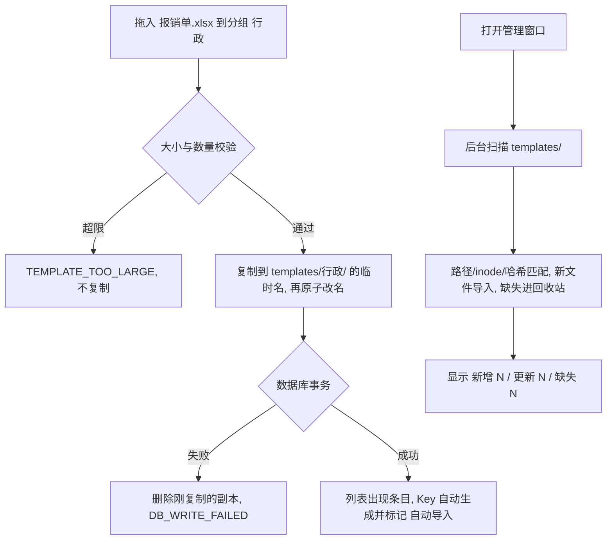

# SPEC-22 文件模板管理：模板目录、导入、外部打开与目录扫描（Schema v5）

## 基本信息

- Spec ID：`SPEC-22`
- 标题：文件模板管理：模板目录、导入、外部打开与目录扫描（Schema v5）
- SpecFlow spec：`file-templates`（状态以 `../state.yaml` 为准）
- 关联阶段：Phase 10 第三 slice
- 关联 PRD：A-03、A-14、A-16、FR-SNP-01（`kind`、`file`）、FR-TPL-01～07、FR-GRP-02（目录同步部分）、FR-MGT-01、FR-MGT-04、FR-SCH-01、8.1 `TemplateFile`、9.3、AC-21/22（目录部分）、AC-24～29、E-21～24、E-27、NFR-PERF-07、D-11～D-15
- 前置 Spec：SPEC-21
- 允许修改范围：
  - `src-tauri/src/**`（新增 `templates/` 模块：目录、扫描、文件操作；`platform/files.rs`：xdg-open、MIME、`.desktop` 枚举与启动）
  - `src-tauri/Cargo.toml`（新增 `umya-spreadsheet` 用于新建空白 xlsx；如需 `notify` 不在本 slice）
  - `src/api/**`、`src/types/**`、`src/components/ManagerWindow.tsx`、`src/components/ui/**`、`src/App.tsx`、`src/index.css`
  - `e2e/**`
- 禁止修改范围：
  - 剪贴板与带格式复制、导出、快搜窗口新快捷键（SPEC-23）
  - 设置视图与备份格式（SPEC-24）
  - KDE Global Menu 菜单结构
  - `docs/prds/**`、`.agent/**`、`.specflow/system-specs/**`、本 change 的规划工件（`proposal.md`、`specs/`、`contracts/`、`design.md`、`ux-design.md`，Planner 专属）

## 背景与目标

用户希望把 md、xlsx 等文件当成模板，由 Searchis 统一管理、用 Key 检索，编辑交给 WPS、Typora 等外部软件。本 slice 让用户在管理窗口导入或新建文件模板，打开、重命名、移动、删除它们；Searchis 维护与分组树一一对应的模板目录，并在管理窗口打开时扫描目录，吸收外部的增删改。快搜窗口能搜到文件模板；本 slice 中对文件模板按 Enter、Ctrl+Enter 不执行任何操作，底栏只显示“编辑 Ctrl+E / 关闭 Esc”，复制与导出由 SPEC-23 提供。

## 用户故事 / 成功标准

- 作为：经常复用 md、xlsx 文件的用户
- 我希望：把文件导入 Searchis，按分组整理，在外部软件里编辑后仍能被正确识别
- 从而：模板集中管理，随时能找到

成功标准：

- [ ] 首次运行本版本时创建 `<应用数据目录>/templates/` 与 `.trash/`（目录权限 `0700`），并为 SPEC-21 已有的分组补建目录；之后分组的新建、重命名、移动、删除同步修改目录（AC-21、AC-22 全部通过）。
- [ ] Schema 迁移到 v5：`snippets` 新增文件模板字段（见数据契约）；迁移前备份 `searchis.db.v4.bak`。
- [ ] 中栏“+”菜单：新建文本片段 / 新建空白 md / 新建空白 xlsx / 导入文件；支持拖入多个文件导入到当前分组；导入复制文件、原文件不动；Key 自动生成规则、`-2` 后缀、“自动导入”标记符合 FR-TPL-01（AC-24）。
- [ ] 单文件 > 20 MB 拒绝（AC-25）；未删除条目合计 > 10,000 拒绝。
- [ ] 右栏文件模板视图：元数据表单（标题、Key、分组、标签、置顶）、文件信息卡片（图标、文件名、大小、修改时间）、按钮“打开”“打开方式…”；“导出”“带格式复制”按钮可见但禁用（SPEC-23 启用）；“放入回收站”在右上角；不显示敏感开关、不预览内容。
- [ ] 标题 ↔ 文件名双向联动、文件名清洗与 ` (2)` 后缀符合 FR-TPL-02。
- [ ] “打开”用 `xdg-open`；“打开方式…”列出支持该 MIME 的 `.desktop` 应用，选择后启动并记住（按扩展名，写入设置 `openWithByExtension`）。启动失败显示 `TEMPLATE_OPEN_FAILED`。
- [ ] 目录扫描符合 FR-TPL-03：路径 → inode → SHA-256 识别；外部改名/移动保留 `id`、Key、使用次数（AC-26）；原子保存导致 inode 变化仍识别（AC-27）；外部删除进回收站标记“文件缺失”、文件回来后自动恢复（AC-28）；外部新子目录成为分组；超过 3 层不导入并提示；忽略规则生效；扫描后台进行，完成后显示变化计数；左栏或列表提供“重新扫描”。
- [ ] 回收站：放入时文件移至 `.trash/<id>.<ext>`；还原回原分组（不存在则未分组，重名加后缀）；彻底删除、清空、自动清理删除文件（AC-29）；`SearchIndex` 与回收站一致（沿用 SPEC-15 的同步路径）。
- [ ] 快搜窗口与管理检索能搜到文件模板（只按 key/aliases/title/tags）；结果行图标按扩展名、徽标为大写扩展名。
- [ ] 所有文件写操作遵守“先文件、后数据库，失败撤销”；撤销失败记录 `TEMPLATE_RECONCILE_PENDING` 并由下一次扫描修正；任何路径都不删除用户文件（回收站彻底删除除外）。
- [ ] `cargo test`、`npm run build`、`npm run test:e2e` 通过。

## 非目标

- 带格式复制、导出、快搜窗口 `Shift+Enter`/`Ctrl+O`、底栏切换（SPEC-23）。
- 文件内容预览、全文检索、实时文件监听（inotify）；扫描只在管理窗口打开和手动触发时进行。
- 设置视图中的模板目录展示（SPEC-24）。
- 引用模板目录外的文件。

## 用户流程



## 接口与契约

### 应用服务 / IPC / 平台接口

| 名称 | 请求 | 成功返回 | 错误码 | 幂等要求 |
|---|---|---|---|---|
| `template_import` | `{ sourcePaths[], groupId, requestId }` | `{ created: Snippet[], rejected: {name, code}[] }` | `TEMPLATE_TOO_LARGE`、`TEMPLATE_FS_FAILED`、`DB_WRITE_FAILED` | 同 `requestId` 不重复导入 |
| `template_create_blank` | `{ kind: 'md' \| 'xlsx', title, key, groupId, requestId }` | `Snippet` | `KEY_CONFLICT`、`TEMPLATE_FS_FAILED` | 同上 |
| `template_update` | `{ id, revision, title, key, groupId, tags, aliases, pinned }` | `Snippet` | `KEY_CONFLICT`、`REVISION_CONFLICT`、`TEMPLATE_FS_FAILED` | revision |
| `template_open` | `{ id, desktopId? }` | `{}` | `TEMPLATE_FILE_MISSING`、`TEMPLATE_OPEN_FAILED` | 无副作用计数 |
| `template_open_with_candidates` | `{ id }` | `{ desktopId, name, icon? }[]` | `TEMPLATE_FILE_MISSING` | 只读 |
| `template_scan` | — | `{ added, updated, missing, restored, skipped: {reason}[] }` | `TEMPLATE_FS_FAILED` | 并发调用合并为一次 |
| `trash_move` / `trash_restore` / `trash_purge_one` / `trash_empty` / `trash_auto_purge` | 不变 | 不变 | 新增 `TEMPLATE_FS_FAILED` | 不变 |

平台适配（Rust，`platform/files.rs`）：

- `xdg_open(path)`：`Command::new("xdg-open").arg(path)`，不经 shell。
- `mime_of(path)`：`xdg-mime query filetype <path>`，失败时按扩展名回退。
- `desktop_entries_for(mime)`：读取 `$XDG_DATA_HOME/applications` 与 `$XDG_DATA_DIRS/*/applications` 下的 `.desktop`，筛选 `MimeType` 含该类型、`NoDisplay≠true`、`Hidden≠true`。
- `launch_desktop(entry, path)`：解析 `Exec`，按规范替换 `%f %F %u %U`，删除其他字段码，以参数数组启动。

### 数据契约

```text
snippets 新增列（v5）：
  file_rel_path TEXT NULL, file_ext TEXT NULL, file_size INTEGER NULL, file_inode INTEGER NULL,
  file_sha256 TEXT NULL, file_mtime TEXT NULL, file_original_group_id TEXT NULL,
  file_auto_imported INTEGER NOT NULL DEFAULT 0, file_missing INTEGER NOT NULL DEFAULT 0
约束：kind='file' ⇒ file_rel_path/ext/size/sha256 非空、sensitive=0、content=''；
      kind='text' ⇒ file_* 全为 NULL；
      UNIQUE(file_rel_path) WHERE file_rel_path IS NOT NULL。
settings 新增：openWithByExtension: Record<string,string>（默认 {}）。
SearchResultItem 新增：fileExt（kind=file 时）。
```

## 数据与状态变化

- 新增状态：文件模板生命周期（PRD 9.3），含 `Missing`。
- 持久化影响：Schema v4 → v5；模板目录。
- 事务边界：每个用户动作“文件操作 → 单事务”；扫描结果按批次（每批 ≤ 500 条）各自成事务，单批失败只回滚该批并在结果中报告。
- 并发 / revision 规则：扫描对条目的修改同样 revision +1；扫描与用户编辑冲突时用户编辑以 `REVISION_CONFLICT` 失败并提示重新载入。
- 索引影响：文件模板进入 `SearchIndex`（无 content）；缺失、回收站条目移出索引。
- 迁移要求：v5 迁移 + 首次运行补建分组目录；补建失败不阻止启动，文件模板功能显示 `TEMPLATE_FS_FAILED`。

## 平台行为

- `xdg-open` / `xdg-mime`：`required`；不可用时“打开”显示 `TEMPLATE_OPEN_FAILED` 并给出“请安装 xdg-utils”提示。
- KGlobalAccel、X11、剪贴板、AppMenu、Autostart：`not_applicable`。

## 安全与隐私

- 所有模板路径由 `templates/` 根 + 校验后的相对路径拼出：规范化后必须仍位于根目录内；拒绝 `..`、绝对路径；扫描不跟随符号链接（`symlink_metadata`）。
- 日志只记录条目 `id`、扩展名、大小、错误码，不记录文件名、相对路径、分组名。
- 导入的源路径只用于一次复制，不持久化。
- 文件模板 `sensitive` 恒为 false；UI 不显示敏感开关；设置页的明文说明由 SPEC-24 提供，本 slice 在导入成功提示中附一句“文件以明文保存在模板目录”。

## 边界与失败场景

| 场景 | 预期行为 | 错误码 | 是否保留原状态 |
|---|---|---|---|
| 导入多个文件中有一个超限 | 其余正常导入，结果列出被拒文件 | `TEMPLATE_TOO_LARGE` | 是（被拒者） |
| 复制后数据库写入失败 | 删除刚复制的副本 | `DB_WRITE_FAILED` | 是 |
| 重命名文件成功但数据库失败，且改回失败 | 记录待修正，下次扫描以磁盘为准更新标题 | `TEMPLATE_RECONCILE_PENDING` | 部分（由扫描收敛） |
| 打开时文件已被外部删除 | 提示并触发一次扫描 | `TEMPLATE_FILE_MISSING` | 是 |
| 模板目录被删除 | 启动时重建空目录；已有条目在扫描中标记缺失 | — | — |
| 外部子目录超过 3 层 | 不建分组、不导入，扫描结果提示 | — | 是 |
| 文件被替换为符号链接或目录 | 视为缺失 | — | 是 |
| 两个文件内容完全相同（哈希冲突） | 哈希匹配只在路径与 inode 都未命中且只有唯一候选时使用 | — | — |
| 扫描进行中用户关闭管理窗口 | 扫描继续完成并提交已完成批次 | — | — |

## 实施要求

1. 文件写入一律“写临时文件 → `rename`”；跨目录移动用 `rename`，失败（跨文件系统）时退回“复制 + 校验哈希 + 删除源”。
2. 扫描算法必须是纯函数核心（输入：数据库快照 + 目录快照；输出：变更计划），便于单元测试；IO 层只负责收集快照和执行计划。
3. 新建空白 xlsx 用 `umya-spreadsheet` 生成单个 `Sheet1`；新建 md 写入 `# <标题>\n`。
4. “自动导入”标记在用户保存一次元数据后清除。

## 测试点

### 单元测试

- [ ] 文件名清洗、重名后缀、Key 自动生成（含中文、非法字符、空结果 → `file`、冲突 `-2`）。
- [ ] 扫描计划：改名（inode）、原子保存（路径）、跨目录移动、外部删除、文件回来恢复、新文件导入、新子目录成分组、超 3 层跳过、忽略规则、符号链接。
- [ ] 路径校验：`..`、绝对路径、符号链接逃逸。
- [ ] “先文件后数据库”补偿：注入数据库失败后文件回到原位。
- [ ] v4 → v5 迁移与约束。
- [ ] `.desktop` 解析与 `Exec` 字段码替换。

### 集成测试

- [ ] E2E（临时 XDG 目录）：导入 md 与 xlsx、修改标题后文件名同步、放入回收站/还原/彻底删除的文件位置、在测试中直接改名目录文件后重新扫描得到同一条目。
- [ ] E2E 不实际启动外部应用：`template_open` 在 E2E 构建中替换为记录调用参数的替身。

### 手动验收

- [ ] 实机：WPS 打开 xlsx 修改并保存后，Searchis 重新扫描仍是同一条目（AC-27）；Dolphin 中改名移动（AC-26）；“打开方式…”列出 WPS 与 LibreOffice（若安装）。

### 性能与资源

- [ ] 2,000 个模板文件无变化扫描 ≤ 2 s（NFR-PERF-07），记录设备信息与样本数。

## 执行与记录（SpecFlow）

> 2026-10-15 起本 spec 由 SpecFlow 管理（change `phase10-file-templates`，spec `file-templates`）。原“实施记录 / QA Result / 完成定义”三节作废，替代关系如下：

- 实施记录 → `handoffs/<task-id>.result.yaml`（`changed_files`、`test_results`、`unresolved_issues`）。
- QA Result → `reviews/<task-id>.md`（含 Design Conformance 节），结论由 runtime 导入后推进状态。
- 手动 / 实机验收项 → QA 报告的“实机验收”清单标为 `pending_human`，由人在归档审批前于 `test_report.md` 执行并勾选；失败时用 `specflow reopen-qa` 退回。
- 完成定义 → 本 spec 的 Delta Spec 场景全部有证据、QA `pass`、`tasks.md` 对应条目勾选。
