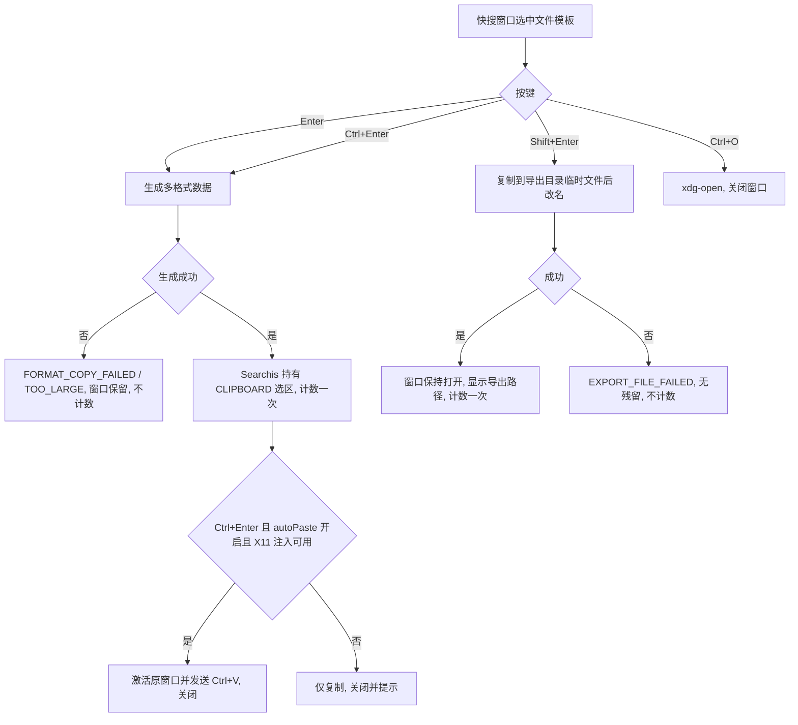

# SPEC-23 快搜窗口文件动作：带格式复制、导出与打开

> 技术依据：`docs/research/xlsx-clipboard-spike.md`（WPS 接受外部提供的 `XML Spreadsheet`；样式不得用 `ss:Parent`；公式不复制）

## 基本信息

- Spec ID：`SPEC-23`
- 标题：快搜窗口文件动作：带格式复制、导出与打开
- SpecFlow spec：`formatted-copy-export`（状态以 `../state.yaml` 为准）
- 关联阶段：Phase 10 第四 slice
- 关联 PRD：FR-PCK-02（v0.4 按键表与 `autoPaste` 修正）、FR-PCK-03、FR-FMT-01～04、FR-EXP-01、AC-30～35、E-25、E-26、NFR-PERF-06、D-16、D-18
- 前置 Spec：SPEC-22
- 允许修改范围：
  - `src-tauri/src/**`（新增 `format_copy/` 模块：md→HTML、xlsx→SpreadsheetML/HTML/TSV、URI 列表；`platform/x11_clipboard.rs`：选区持有者；导出服务）
  - `src-tauri/Cargo.toml`（新增 `pulldown-cmark`、`x11rb`；复用 SPEC-22 的 `umya-spreadsheet` 读取 xlsx）
  - `src/components/QuickSearchWindow.tsx`、`src/components/ManagerWindow.tsx`（启用“导出”“带格式复制”按钮）、`src/components/KeyboardShortcutsModal.tsx`、`src/api/**`、`src/types/**`、`src/index.css`
  - `e2e/**`
- 禁止修改范围：
  - 文本片段的剪贴板写入路径（继续使用现有封装，行为不变）
  - 设置视图 UI（导出目录的修改界面在 SPEC-24；本 slice 只读取设置值，默认 `null`）
  - 备份格式、分组与扫描逻辑
  - `docs/prds/**`、`.agent/**`、`.specflow/system-specs/**`、本 change 的规划工件（`proposal.md`、`specs/`、`contracts/`、`design.md`、`ux-design.md`，Planner 专属）

## 背景与目标

文件模板的核心价值是“快速取用”：在快搜窗口选中后，Enter 把带格式的内容放进剪贴板，粘贴到 WPS 等应用时保留格式；Shift+Enter 导出一份副本继续填写；Ctrl+O 用默认软件打开。本 slice 实现这三个动作、底栏提示随条目类型切换、快捷键速查按类型列出，并修正 `autoPaste` 设置在快搜窗口中不生效的问题。

## 用户故事 / 成功标准

- 作为：使用 WPS、Typora、文件管理器的用户
- 我希望：在快搜窗口里一个按键就能带格式地复制、导出或打开模板
- 从而：不必先找到文件、打开、全选、复制

成功标准：

- [ ] 快搜窗口按键行为与 PRD FR-PCK-02 v0.4 表格逐项一致；`Ctrl+1`～`Ctrl+9` 对文件模板执行“带格式复制并自动粘贴”。
- [ ] `autoPaste=false` 时，文本片段与文件模板的 `Ctrl+Enter`、`Ctrl+数字` 均退化为仅复制并关闭，提示“自动粘贴已在设置中关闭”（AC-35）。后端以设置值与请求标志的“与”作为最终判定，前端不再自行决定。
- [ ] Searchis 持有 X11 CLIPBOARD 选区：响应 `TARGETS`、按请求格式返回数据、超过最大请求尺寸时使用 INCR；收到 `SelectionClear` 后释放数据。
- [ ] md：提供 `text/html` 与 `text/plain`；GFM 表格、任务列表、删除线；原始 HTML 被转义（AC-30）。
- [ ] xlsx：活动工作表已用区域 ≤ 50,000 单元格；提供 `XML Spreadsheet`、`text/html`、`text/plain`（TSV）；保留 FR-FMT-03 列出的格式；样式完整展开无 `ss:Parent`；公式写缓存值（无缓存值写空并提示）；超过上限显示 `FORMAT_COPY_TOO_LARGE` 并建议导出（AC-31、E-25）。
- [ ] 其他类型：提供 `text/uri-list`、`x-special/gnome-copied-files`（`copy\nfile:///...`）与 `text/plain`（绝对路径）（AC-32）。
- [ ] 带格式复制成功后按 FR-PCK-03 计数一次（`operationId` 幂等），Enter 关闭窗口；失败不计数、窗口保留并显示错误。
- [ ] `Shift+Enter` 导出符合 FR-EXP-01：默认 XDG 下载目录、`<标题>_<YYYY-MM-DD>.<ext>`、` (2)` 后缀不覆盖、临时文件后原子改名、成功后窗口保持打开并显示路径、计数一次；失败显示 `EXPORT_FILE_FAILED` 且无残留（AC-33、AC-34）。
- [ ] `Ctrl+O` 调用 SPEC-22 的 `template_open`，不计数，成功后关闭窗口。
- [ ] 管理窗口右栏“导出”“带格式复制”按钮启用，复用同一后端命令。
- [ ] 底栏提示按选中条目类型切换（文件：带格式复制 ↵ / 粘贴 Ctrl+↵ / 导出 Shift+↵ / 打开 Ctrl+O / 编辑 Ctrl+E / 关闭 Esc；文本：复制 ↵ / 粘贴 Ctrl+↵ / 编辑 Ctrl+E / 关闭 Esc）；快捷键速查弹窗按“文本片段 / 文件模板”分组列出。
- [ ] 输入法组合态下以上按键均不触发（AC-12 回归）。
- [ ] `cargo test`、`npm run build`、`npm run test:e2e` 通过。

## 非目标

- xlsx 公式、图片、图表、批注、条件格式、数据验证的复制。
- 多工作表一次复制；选择工作表或区域的界面。
- Searchis 退出后保留富文本剪贴板（已接受的限制，E-26）。
- 修改导出目录的界面（SPEC-24）。

## 用户流程



## 接口与契约

### 应用服务 / IPC / 平台接口

| 名称 | 请求 | 成功返回 | 错误码 | 幂等要求 |
|---|---|---|---|---|
| `template_format_copy` | `{ id, operationId, autoPaste }` | `PasteOutcome` + `notes: string[]`（如“公式已转为数值”） | `TEMPLATE_FILE_MISSING`、`FORMAT_COPY_FAILED`、`FORMAT_COPY_TOO_LARGE`、`X11_AUTOMATION_UNAVAILABLE`（仅降级提示） | 同 `operationId` 只计数一次 |
| `template_export` | `{ id, operationId }` | `{ path, counted }` | `TEMPLATE_FILE_MISSING`、`EXPORT_FILE_FAILED` | 同 `operationId` 不重复导出 |
| `execute_paste` | 不变 | 不变 | 不变 | 行为修正：最终 autoPaste = 请求值 && `settings.autoPaste` |
| `template_open` | 见 SPEC-22 | — | — | — |

平台适配 `platform/x11_clipboard.rs`（基于 `x11rb`）：

- 独立线程持有一个不可见窗口作为选区所有者；`set_formats(Vec<(target_atom_name, bytes)>)` 原子替换数据并调用 `SetSelectionOwner`，确认成为所有者后才返回成功。
- 处理 `SelectionRequest`：`TARGETS`、`TIMESTAMP`、各数据格式；数据超过 `max_request_size` 时走 INCR。
- `SelectionClear` 后清空数据。应用退出时不做额外处理。

### 数据契约

```text
无 schema 变更。Settings 读取 exportDir（null → XDG 下载目录 → ~/Downloads → $HOME）。
剪贴板格式名：
  "text/html"、"text/plain"、"UTF8_STRING"、"XML Spreadsheet"、"text/uri-list"、"x-special/gnome-copied-files"
xlsx 转换输出：
  SpreadsheetML：<Styles> 中每个样式完整展开；<Column ss:Width>；<Row ss:Height>；
  <Cell ss:MergeAcross/ss:MergeDown ss:StyleID>；<Data ss:Type="String|Number|DateTime|Boolean">；不写 ss:Formula。
  HTML：<table> + 内联 style（font、color、background、border、text-align、white-space）+ colspan/rowspan + <col width>。
  TSV：值以 \t 分隔、\r\n 换行；含制表符/换行的单元格按 Excel 规则加双引号。
```

## 数据与状态变化

- 新增状态：剪贴板选区所有权（内存，进程内）。
- 持久化影响：`usageCount`/`lastUsedAt` 更新（与现有粘贴同一原子更新路径）。
- 事务边界：先生成数据并成为选区所有者，再在单事务中计数；成为所有者失败时不计数。导出：文件改名成功后再计数。
- 索引影响：使用次数变化刷新排序。
- 迁移要求：无。

## 平台行为

- 系统剪贴板：`required`（X11 选区持有）。不可用（无 X11 连接）时 `FORMAT_COPY_FAILED`。
- X11 窗口激活与键盘事件注入：`required`（Ctrl+Enter）；不可用时退化为仅复制（复用现有能力检测）。
- 其余 `not_applicable`。

## 安全与隐私

- md→HTML：`pulldown-cmark` 的 `Event::Html`/`Event::InlineHtml` 转义输出；链接仅保留 `http`、`https`、`mailto`、相对路径。
- 生成的 HTML 只进入剪贴板，不在 Searchis 界面渲染（AGENT.md §4）。
- 日志不记录文件名、路径与内容；导出提示显示完整路径（用户本人可见的 UI，不是通知或日志）。
- 导出文件权限沿用用户 umask。

## 边界与失败场景

| 场景 | 预期行为 | 错误码 | 是否保留原状态 |
|---|---|---|---|
| xlsx 损坏或加密 | 拒绝并建议用外部软件打开 | `FORMAT_COPY_FAILED` | 是 |
| xlsx 超过 50,000 单元格 | 拒绝并建议导出 | `FORMAT_COPY_TOO_LARGE` | 是 |
| 公式无缓存值 | 写空值，结果 `notes` 提示 | — | — |
| md 不是有效 UTF-8 | `text/plain` 按有损转换，HTML 同源；提示编码问题 | — | — |
| 导出目录不存在 | 不自动创建，显示错误 | `EXPORT_FILE_FAILED` | 是 |
| 导出期间同名文件被外部创建 | 改名用不覆盖语义（`renameat2 RENAME_NOREPLACE` 或 `link`+`unlink`），冲突时递增后缀重试 | — | — |
| 文件已被外部删除 | 提示并触发扫描 | `TEMPLATE_FILE_MISSING` | 是 |
| 带格式复制后 Searchis 退出 | Klipper 只保留纯文本 | — | 已接受 |
| 其他程序随后写剪贴板 | 收到 SelectionClear，释放数据 | — | — |

## 实施要求

1. 格式转换为纯函数（输入文件字节，输出各格式字节），与 X11 和数据库解耦，便于单元测试。
2. 在 E2E 构建中，剪贴板写入替换为记录“格式名 → 字节长度/哈希”的替身；**不在自动化测试中写真实剪贴板**（CLAUDE.md 约束）。
3. 文本片段的现有复制/粘贴路径不改动，只修正 `autoPaste` 判定。

## 测试点

### 单元测试

- [ ] md→HTML：标题、列表、表格、任务列表、代码块、原始 HTML 转义、`javascript:` 链接剔除。
- [ ] xlsx→SpreadsheetML：用固定样例（含预研 `test2.xml` 对应的 xlsx）断言无 `ss:Parent`、合并、列宽、行高、数字格式、日期、公式写缓存值。
- [ ] xlsx→HTML/TSV：colspan/rowspan、转义、TSV 引号规则。
- [ ] 50,000 单元格上限。
- [ ] 导出文件名生成、后缀递增、不覆盖、失败无残留。
- [ ] `execute_paste` 的 autoPaste 与设置取“与”。
- [ ] `operationId` 幂等计数。

### 集成测试

- [ ] E2E：文件模板选中时底栏文案切换；Enter 后替身记录到正确格式集合且窗口关闭、使用次数 +1；Shift+Enter 在临时导出目录生成文件且窗口保持打开；`autoPaste=false` 时 Ctrl+Enter 不注入。

### 手动验收（需 Orchestrator 明确授权写真实剪贴板）

- [ ] AC-30：md 粘贴到 WPS 文字。
- [ ] AC-31：xlsx 粘贴到 WPS 表格空白工作表，对照原文件截图。
- [ ] AC-32：pdf 粘贴到 Dolphin。
- [ ] 粘贴到纯文本编辑器得到源码 / TSV / 路径。

### 性能与资源

- [ ] NFR-PERF-06：1 MB md、5,000 单元格 xlsx 各 100 次，记录 p95。

## 执行与记录（SpecFlow）

> 2026-10-15 起本 spec 由 SpecFlow 管理（change `phase10-file-templates`，spec `formatted-copy-export`）。原“实施记录 / QA Result / 完成定义”三节作废，替代关系如下：

- 实施记录 → `handoffs/<task-id>.result.yaml`（`changed_files`、`test_results`、`unresolved_issues`）。
- QA Result → `reviews/<task-id>.md`（含 Design Conformance 节），结论由 runtime 导入后推进状态。
- 手动 / 实机验收项 → QA 报告的“实机验收”清单标为 `pending_human`，由人在归档审批前于 `test_report.md` 执行并勾选；失败时用 `specflow reopen-qa` 退回。
- 完成定义 → 本 spec 的 Delta Spec 场景全部有证据、QA `pass`、`tasks.md` 对应条目勾选。
