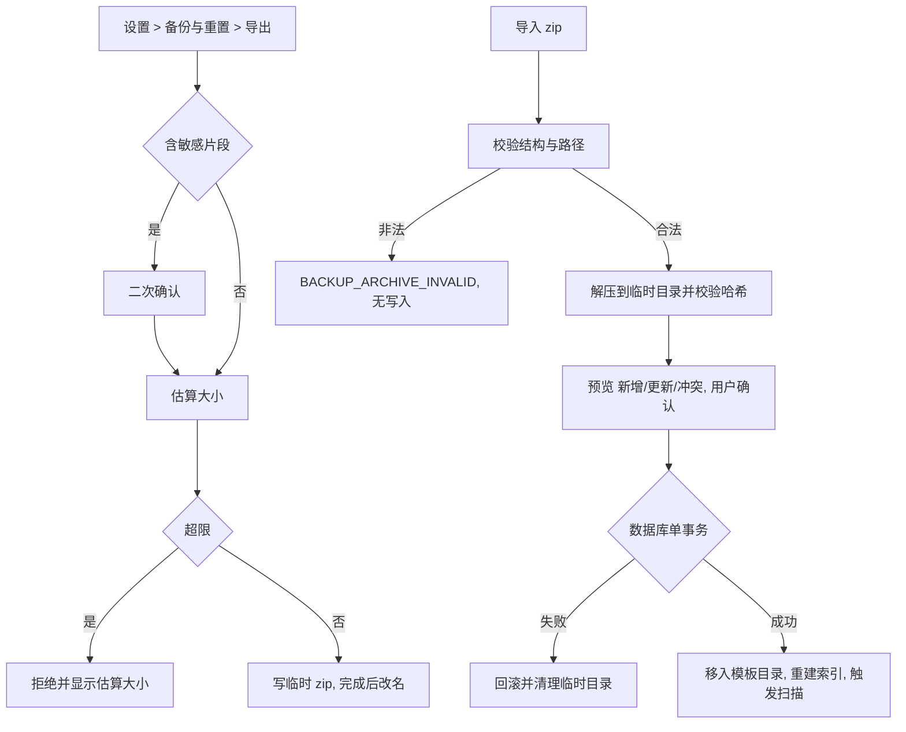

# SPEC-24 设置视图改版与 zip 备份

## 基本信息

- Spec ID：`SPEC-24`
- 标题：设置视图改版（S1）与 zip 备份、恢复、重置
- SpecFlow spec：`settings-backup`（状态以 `../state.yaml` 为准）
- 关联阶段：Phase 10 第五 slice（收口）
- 关联 PRD：FR-SET-01（v0.4 设置视图与“文件与导出”）、FR-DAT-01～03（v0.4）、8.2、8.3 `SearchisBackupV2`、AC-36、AC-37、A-14（明文说明）、D-12
- 前置 Spec：SPEC-23
- 允许修改范围：
  - `src-tauri/src/**`（备份 v2 导出/校验/导入、重置扩展、设置项 `exportDir`）
  - `src-tauri/Cargo.toml`（新增 `zip`；新增 `tauri-plugin-dialog` 用于选择目录与备份文件）
  - `src-tauri/capabilities/**`（对话框权限）
  - `src/components/SettingsModal.tsx`（改为设置视图，可重命名为 `SettingsView.tsx`）、`AboutModal.tsx`（并入设置“关于”分节后删除）、`src/App.tsx`、`src/components/ManagerWindow.tsx`（左栏切换到设置导航）、`src/api/**`、`src/types/**`、`src/index.css`
  - `e2e/**`
  - `index.html`（仅删除 Google Fonts 远程 Figtree 引用与 preconnect、修正 description 中的“MacOS 风格”——2026-10-19 人工授权，补 SPEC-20 遗漏）
- 禁止修改范围：
  - 带格式复制、扫描与文件操作核心逻辑（只调用，不改）
  - KDE Global Menu 菜单结构（“关于”菜单项改为打开设置的“关于”分节，命令 ID 不变）
  - `docs/prds/**`、`.agent/**`、`.specflow/system-specs/**`、本 change 的规划工件（`proposal.md`、`specs/`、`contracts/`、`design.md`、`ux-design.md`，Planner 专属）

## 背景与目标

文件模板落地后，旧的 JSON 备份会丢失分组、语言和全部模板文件；导出目录也没有修改入口。本 slice 把设置从弹窗改为管理窗口内的设置视图（方案 S1），新增“文件与导出”分节，把“关于”并入设置，并把备份升级为 zip（`backup.json` + `templates/`），保证分组、条目和文件可以完整往返。重置示例数据同步清理模板。

## 用户故事 / 成功标准

- 作为：依赖 Searchis 保存模板的用户
- 我希望：备份包含全部分组、条目和文件，能修改导出目录，设置页结构清晰
- 从而：换机或误操作后能完整恢复

成功标准：

- [ ] 设置视图：左栏与管理窗口左栏同宽同样式，分节导航为“返回片段、快捷键与启动、粘贴行为、外观主题、文件与导出、检索与数据、备份与重置、关于”；点击跳转对应分节，“返回片段”回到管理视图；Esc 同样返回。
- [ ] “文件与导出”：显示当前导出目录（默认显示解析后的 XDG 下载目录）、“选择…”按钮（系统目录对话框）、“恢复默认”；文件名规则说明；模板目录路径（只读）与“打开”按钮（`xdg-open` 目录）；文字说明“文件模板以明文存放，不受数据库加密保护”。
- [ ] 选择的导出目录写入 `settings.exportDir` 并即时生效；目录不可写时拒绝保存并提示。
- [ ] “关于”分节内容与原 AboutModal 一致；AboutModal 删除且零引用；Global Menu“关于”打开该分节。
- [ ] 导出备份：`searchis-backup-YYYYMMDD-HHmmss.zip`，内含 `backup.json`（`schemaVersion: 2`，含 `groups`、`snippets`、`settings`）与 `templates/`（含 `.trash/`）；`backup.json` ≤ 100 MB、zip ≤ 1 GB，超限拒绝并显示估算大小；含敏感片段时二次确认（沿用现有流程）；先写临时文件再改名。
- [ ] 导入备份：接受 v2 zip 与 v1 JSON；zip 中路径校验（拒绝绝对路径、`..`、符号链接、未被引用的文件），失败显示 `BACKUP_ARCHIVE_INVALID`（AC-37）；文件先解压到临时目录并校验大小与 SHA-256，数据库单事务成功后再移入模板目录；任一步失败清理临时目录，数据库与模板目录保持原状。
- [ ] 导入冲突策略沿用 FR-DAT-02（按 ID 覆盖、缺失新增、未包含保留、Key 冲突由用户选择）；文件模板覆盖时替换文件；分组按 ID 合并，同级重名加 `(2)`。
- [ ] 重置示例数据：确认文案注明会删除文件模板；模板目录先改名为临时目录，数据库事务成功后删除，失败改回。
- [ ] AC-36 往返测试通过（哈希一致）。
- [ ] `cargo test`、`npm run build`、`npm run test:e2e` 通过。

## 非目标

- 备份加密、增量备份、定时备份。
- 设置项以外的新功能；数据目录、日志目录的展示维持现状。

## 用户流程



## 接口与契约

### 应用服务 / IPC / 平台接口

| 名称 | 请求 | 成功返回 | 错误码 | 幂等要求 |
|---|---|---|---|---|
| `export_preview` | 不变 | 新增 `templateCount`、`templateBytes` | 不变 | 只读 |
| `export_confirm` | `{ path }` | `ExportOutcome` + `templateCount` | `EXPORT_FAILED` | 目标存在时不覆盖 |
| `import_validate` | `{ path }` | `ImportValidation` + `backupVersion`、`groupCount`、`templateCount` | `IMPORT_SCHEMA_INVALID`、`IMPORT_TOO_LARGE`、`BACKUP_ARCHIVE_INVALID` | 只读（临时目录随 token 管理） |
| `import_commit` | 不变 | 不变 | 新增 `TEMPLATE_FS_FAILED` | 同 `importToken` 只提交一次 |
| `reset_examples` | 不变 | 不变 | 新增 `TEMPLATE_FS_FAILED` | 不变 |
| `settings_update` | 新增键 `exportDir` | 不变 | `VALIDATION_FAILED`（目录不存在或不可写） | revision |
| `templates_dir_open` | — | `{}` | `TEMPLATE_OPEN_FAILED` | 无副作用 |

### 数据契约

```text
zip 结构：
  backup.json            SearchisBackupV2（PRD 8.3）
  templates/<relativePath>   每个 kind=file 条目一个文件（含 .trash/<id>.<ext>）
校验：每个 kind=file 条目必须有对应文件且 SHA-256 一致；不得存在多余文件。
导入临时目录：<应用数据目录>/import-staging-<token>/，提交或失败后删除；应用启动时清理遗留目录。
```

## 数据与状态变化

- 新增状态：设置视图当前分节（前端状态，不持久化）；`exportDir`。
- 持久化影响：备份格式 v2；导入写入分组、条目与模板文件。
- 事务边界：导入与重置的数据库部分各为单事务；文件部分采用“临时目录 + 改名”与失败回滚。
- 并发 / revision 规则：导入进行中禁用管理窗口写操作并暂停扫描。
- 索引影响：导入或重置后重建 `SearchIndex`。
- 迁移要求：无 schema 变更。

## 平台行为

- 文件对话框：`required`（`tauri-plugin-dialog`，KDE 下走 xdg-desktop-portal）；不可用时导出目录输入框允许手动输入路径。
- `xdg-open`：打开模板目录。
- 其余 `not_applicable`。

## 安全与隐私

- 备份为明文，导出前沿用敏感确认；说明文字补充“备份包含文件模板原文件”。
- zip 解压做路径穿越、符号链接、解压炸弹防护（单文件 ≤ 20 MB、总解压量 ≤ 1 GB、条目数 ≤ 20,000）。
- 日志不记录备份路径与文件名，只记录数量、大小与错误码。

## 边界与失败场景

| 场景 | 预期行为 | 错误码 | 是否保留原状态 |
|---|---|---|---|
| zip 含 `../x` 或绝对路径 | 拒绝 | `BACKUP_ARCHIVE_INVALID` | 是 |
| zip 中文件哈希与 `backup.json` 不符 | 拒绝 | `BACKUP_ARCHIVE_INVALID` | 是 |
| 解压总量超过 1 GB | 拒绝 | `IMPORT_TOO_LARGE` | 是 |
| 导入事务成功但移入模板目录失败 | 回滚数据库（补偿事务）并清理临时目录 | `TEMPLATE_FS_FAILED` | 是 |
| 导入 v1 JSON | 全部视为未分组文本片段 | — | — |
| 应用在导入中崩溃 | 启动时清理 `import-staging-*`，数据库未提交则不变 | — | 是 |
| 选择的导出目录不可写 | 拒绝保存设置 | `VALIDATION_FAILED` | 是 |

## 实施要求

1. 备份读写与校验为独立模块，导出与导入共用同一 schema 定义与校验函数。
2. 现有 v1 导入路径保留并复用。
3. 设置视图沿用 SPEC-20 视觉 token，不新增硬编码颜色。

## 测试点

### 单元测试

- [ ] v2 导出 → 校验 → 导入往返（分组、条目、文件哈希）。
- [ ] 路径穿越、符号链接、多余文件、哈希不符、超限的拒绝。
- [ ] 导入失败各阶段的回滚（注入失败）。
- [ ] 重置的目录改名与失败恢复。
- [ ] `exportDir` 校验。

### 集成测试

- [ ] E2E：设置视图分节导航与返回；修改导出目录后 SPEC-23 的导出写到新目录；导出 zip → 重置 → 导入（AC-36）。

### 手动验收

- [ ] 实机：KDE 目录选择对话框可用；“打开模板目录”在 Dolphin 中打开；浅色、深色设置视图截图。

### 性能与资源

- [ ] 500 MB 模板总量的导出、导入耗时记录（不设硬指标，确保界面不冻结并显示进度）。

## 执行与记录（SpecFlow）

> 2026-10-15 起本 spec 由 SpecFlow 管理（change `phase10-file-templates`，spec `settings-backup`）。原“实施记录 / QA Result / 完成定义”三节作废，替代关系如下：

- 实施记录 → `handoffs/<task-id>.result.yaml`（`changed_files`、`test_results`、`unresolved_issues`）。
- QA Result → `reviews/<task-id>.md`（含 Design Conformance 节），结论由 runtime 导入后推进状态。
- 手动 / 实机验收项 → QA 报告的“实机验收”清单标为 `pending_human`，由人在归档审批前于 `test_report.md` 执行并勾选；失败时用 `specflow reopen-qa` 退回。
- 完成定义 → 本 spec 的 Delta Spec 场景全部有证据、QA `pass`、`tasks.md` 对应条目勾选。
